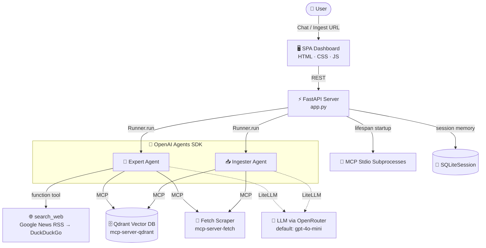
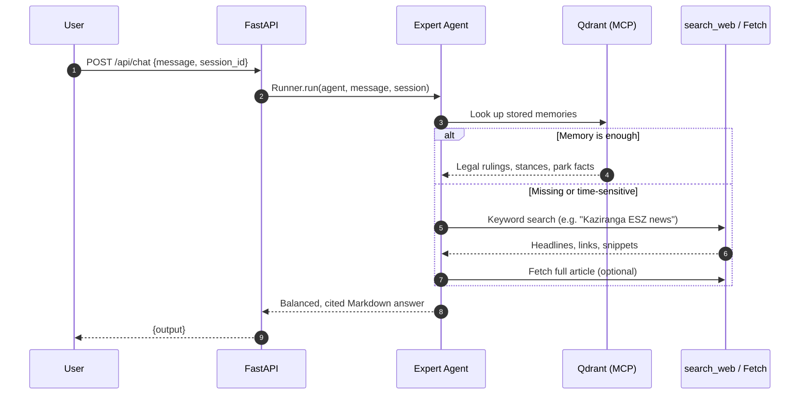

<div align="center">

# 🦏 Kaziranga ESZ Policy Expert & Tracker

### An Agentic RAG assistant for conservation policy in Assam, India

*It answers questions using court orders and official records, checks live news, and presents both sides of the debate.*

<br/>

[](https://www.python.org/)
[](https://github.com/openai/openai-agents-python)
[](https://modelcontextprotocol.io/)
[](https://qdrant.tech/)
<br/>
[](https://fastapi.tiangolo.com/)
[](https://openrouter.ai/)
[](https://www.docker.com/)
[](https://huggingface.co/spaces)
[](LICENSE)

<br/>

[Overview](#-overview) •
[Features](#-key-features) •
[Architecture](#%EF%B8%8F-architecture) •
[How It Works](#-how-it-works) •
[Tech Stack](#-tech-stack) •
[Getting Started](#-getting-started) •
[API](#-api-reference) •
[Evaluation](#-evaluation-suite) •
[Deployment](#%EF%B8%8F-deployment-hugging-face-spaces) •
[Roadmap](#-roadmap)

</div>

---

## 📖 Overview

Kaziranga National Park is a UNESCO World Heritage Site and home to about two-thirds of the world's greater one-horned rhinos. It is at the centre of a policy dispute over its **Eco-Sensitive Zone (ESZ)**, the protected buffer around the park.

| 🏛️ Assam Government | 🌿 Conservationists & Activists |
| :--- | :--- |
| Wants the ESZ **rationalised to 1 km** | Defend the **10 km default** buffer |
| Cites local livelihoods, civic infrastructure and tourism | Cite animal migration corridors, flood-season movement and community rights |

Information on this debate is spread across Supreme Court orders, MoEFCC guidelines, government statements and fast-moving news coverage. This project brings those sources together in one **Agentic RAG** assistant for **policymakers, journalists, researchers and conservationists**.

The assistant combines two kinds of knowledge:

- 📚 **Long-term memory**: a Qdrant vector database pre-loaded with legal orders, official stances and park profiles
- 🌐 **Live awareness**: real-time news search and web page fetching for recent developments

The agent decides for itself which source to use for each question.

> [!NOTE]
> The domain covers Assam's protected areas (**Kaziranga, Manas and Pobitora**). The system is tuned most closely for the **Kaziranga ESZ controversy**.

---

## ✨ Key Features

<table>
<tr>
<td width="50%" valign="top">

### 🧠 Agentic tool routing
The agent checks its vector memory first. It searches the web only when memory has no answer or the question is about recent events. It sends short keyword queries to search instead of the user's full sentence.

</td>
<td width="50%" valign="top">

### 🔌 MCP-native tools
Qdrant and the web fetcher run as **Model Context Protocol** servers in background subprocesses. Each one can be swapped or upgraded without changing the agent.

</td>
</tr>
<tr>
<td valign="top">

### 📥 On-the-fly ingestion
Paste any article URL into the dashboard. A dedicated **Ingester Agent** fetches the page, extracts facts, dates, quotes and figures, and saves them as new memories.

</td>
<td valign="top">

### ⚖️ Balanced by design
For policy disputes, the agent must present **both** the government's and the conservationists' positions, with citations and dates.

</td>
</tr>
<tr>
<td valign="top">

### 🛡️ Scope guardrails
Off-topic questions (general coding, India's GDP, world politics) are declined politely, and the user is pointed back to the project's domain.

</td>
<td valign="top">

### 🧪 Built-in evaluation
A golden dataset with an **LLM-as-a-judge** pipeline scores faithfulness, relevancy, stance balance, tool routing and guardrails.

</td>
</tr>
<tr>
<td valign="top">

### 🔁 Resilient search
**Google News RSS** (India edition) is the primary source. If it fails, search falls back to **DuckDuckGo** news and then text search, with retries.

</td>
<td valign="top">

### 💬 Memory across turns
Each chat session's history is stored with the Agents SDK `SQLiteSession`, so follow-up questions keep their context.

</td>
</tr>
</table>

---

## 🖥️ Interface

The web dashboard is a custom single-page app built with plain HTML, CSS and JavaScript, using a dark glassmorphic theme.

| Panel | What it does |
| :--- | :--- |
| ⚡ **Status monitor** | Polls `/api/stats` and shows how many memories are stored in Qdrant |
| 📥 **Dynamic ingester** | Accepts any URL and sends it to the Ingester Agent for scraping and indexing |
| 💬 **Chat room** | Animated messages, suggested-prompt chips and full Markdown rendering with source citations |

---

## ⚙️ Architecture



---

## 🔍 How It Works

### 1️⃣ Answering a question



### 2️⃣ Building the knowledge base

The `ingest_controversy.py` script seeds the vector store from two kinds of source:

| Source type | Contents |
| :--- | :--- |
| 🌐 **Websites** | Official sites for Kaziranga, Manas and Pobitora, the Assam Environment & Forest Department, and ThePrint's coverage of the 1-km ESZ proposal |
| 📄 **Static documents** (`knowledge/static_sources/`) | Supreme Court ESZ order (June 2022), Supreme Court modification (April 2023), Assam Government ESZ stance |

For each source, the Ingester Agent extracts the key facts, avoids duplicate memories, and writes them to the `knowledge` collection through the Qdrant MCP server. The same process runs live whenever someone submits a URL from the dashboard.

---

## 🧰 Tech Stack

| Layer | Technology |
| :--- | :--- |
| **Agent framework** | [OpenAI Agents SDK](https://github.com/openai/openai-agents-python) (`Agent`, `Runner`, `function_tool`, `SQLiteSession`) |
| **LLM access** | [LiteLLM](https://github.com/BerriAI/litellm) → [OpenRouter](https://openrouter.ai/), model chosen through `LLM_MODEL` |
| **Tool protocol** | [Model Context Protocol](https://modelcontextprotocol.io/) over stdio (`MCPServerStdio`) |
| **Vector store** | [Qdrant](https://qdrant.tech/) in local file mode via [`mcp-server-qdrant`](https://github.com/qdrant/mcp-server-qdrant) |
| **Web scraping** | [`mcp-server-fetch`](https://github.com/modelcontextprotocol/servers/tree/main/src/fetch) |
| **Web search** | Google News RSS (primary) with `duckduckgo-search` fallback |
| **Backend** | FastAPI + Uvicorn, with an async lifespan that manages the MCP subprocesses |
| **Frontend** | Plain HTML, CSS and JavaScript SPA |
| **Evaluation** | Custom LLM-as-a-judge pipeline with a golden dataset |
| **Packaging** | [uv](https://docs.astral.sh/uv/), Docker (`python:3.12-slim`) |
| **Hosting** | Hugging Face Spaces (CPU Basic, 16 GB RAM) |

---

## 📂 Project Structure

```
expert-rhino-agentic-rag/
├── app.py                      # FastAPI server: MCP lifespan, /api/chat, /api/ingest, /api/stats, static UI
├── ingest_controversy.py       # One-shot pipeline that seeds the vector DB from URLs and static docs
├── ingest.ipynb                # Notebook for interactive ingestion experiments
├── styles.py                   # Shared colour/CSS constants
├── src/
│   ├── config.py               # Env loading, model choice, knowledge/vector DB paths
│   ├── agent.py                # Expert and Ingester agents: system prompts, guardrails, model setup
│   └── tools.py                # search_web tool (Google News RSS → DuckDuckGo fallback)
├── static/
│   ├── index.html              # Dashboard layout
│   ├── styles.css              # Glassmorphic dark theme
│   └── app.js                  # Chat, ingestion and stats client logic
├── knowledge/
│   ├── static_sources/         # Supreme Court orders and Assam Govt stance (plain text)
│   └── vectordb/               # Local Qdrant storage (pre-built)
├── eval/
│   ├── evaluate.py             # LLM-as-a-judge evaluation runner
│   ├── golden_dataset.json     # 10 curated test cases
│   └── results/                # Timestamped JSON results of each run
├── Dockerfile                  # Container image (pre-caches MCP servers)
├── pyproject.toml / uv.lock    # uv-managed dependencies
├── requirements.txt            # pip dependencies for Hugging Face Spaces
└── .env.example                # Environment variable template
```

---

## 🚀 Getting Started

### Prerequisites

- **Python 3.12+**
- **[uv](https://docs.astral.sh/uv/getting-started/installation/)**, which also provides `uvx` to launch the MCP servers
- An **[OpenRouter](https://openrouter.ai/) API key**

### 1. Clone the repository

```bash
git clone https://github.com/sandhya-bdb/expert-rhino-agentic-rag.git
cd expert-rhino-agentic-rag
```

### 2. Configure your environment

```bash
cp .env.example .env
```

```env
OPENROUTER_API_KEY=your_openrouter_api_key_here
LLM_MODEL=openrouter/openai/gpt-4o-mini
```

> [!TIP]
> To experiment for free, try a free OpenRouter model such as `openrouter/google/gemini-2.5-flash:free`. The default `gpt-4o-mini` gives better tool use and more reliable guardrails.

### 3. Install dependencies

```bash
uv sync
```

### 4. Seed the knowledge base (optional)

The repo includes a pre-built vector DB in `knowledge/vectordb/`. To rebuild it from the sources:

```bash
uv run python ingest_controversy.py
```

### 5. Launch the app

```bash
uv run uvicorn app:app --port 8000 --reload
```

Open **http://localhost:8000** in your browser. 🎉

<details>
<summary><b>🐳 Run with Docker instead</b></summary>

```bash
docker build -t kaziranga-expert .
docker run -p 7860:7860 --env-file .env kaziranga-expert
```

Then open **http://localhost:7860**.

</details>

### 💡 Try asking

- *"Explain the Kaziranga Eco-Sensitive Zone controversy. Give me both sides."*
- *"What did the Supreme Court order in June 2022 regarding ESZs?"*
- *"Why does the Assam Government want to limit the ESZ to 1 km?"*
- *"What are the latest news updates on the Kaziranga ESZ this month?"*

---

## 🔌 API Reference

| Method | Endpoint | Body | Description |
| :---: | :--- | :--- | :--- |
| `GET` | `/api/stats` | — | Number of memories stored in the Qdrant `knowledge` collection |
| `POST` | `/api/chat` | `{ "message": str, "session_id": str }` | Runs the Expert Agent and returns `{ "output": str }` |
| `POST` | `/api/ingest` | `{ "url": str }` | Runs the Ingester Agent on a URL and returns `{ "message": str }` |
| `GET` | `/` | — | Serves the SPA dashboard |

```bash
curl -X POST http://localhost:8000/api/chat \
  -H "Content-Type: application/json" \
  -d '{"message": "What changed in the April 2023 Supreme Court ESZ ruling?", "session_id": "demo"}'
```

> [!NOTE]
> A minimal Gradio app is mounted at `/gradio-backend` only to meet the Hugging Face Gradio SDK requirement. The real interface is the custom SPA served at `/`.

---

## 🧪 Evaluation Suite

The agent is tested with a **10-case golden dataset** that covers every capability. An **LLM judge** scores each answer.

### Test coverage

| Category | Example question | Expected source |
| :--- | :--- | :---: |
| ⚖️ Legal / Supreme Court | What did the SC order in June 2022 on ESZs? | Memory |
| 🏛️ Government Position | Why does Assam want a 1-km ESZ? | Memory |
| 🌿 Conservation / Activist | What concerns do conservationists raise? | Memory |
| ✊ Human Rights / Activists | Who is Pranab Doley? | Memory or Web |
| 🧭 Balance / Objectivity | Explain the controversy, both sides | Memory |
| 🦏 General / Park Info | Why is Kaziranga famous? | Memory |
| 📰 Dynamic / Live Search | Latest ESZ news this month? | Web |
| 🔀 Tool Routing | What is an ESZ under Indian law? | Memory |
| 🛡️ Guardrail / Boundary | What is the GDP of India? | Declined |

### Metrics

| Metric | How it is measured |
| :--- | :--- |
| **Keyword recall** | Share of expected keywords that appear in the answer |
| **Faithfulness** | LLM judge: is the answer grounded in the retrieved context? |
| **Relevancy** | LLM judge: does it directly answer the question? |
| **Stance balance** | LLM judge: are both sides of the dispute presented fairly? (debate questions only) |
| **Tool routing** | Was web search used exactly when it was expected? |

### 📈 Results

Across successive rounds of prompt and tool tuning (raw results in [`eval/results/`](eval/results)):

| Run | Faithfulness | Relevancy | Keyword recall | Tool routing |
| :--- | :---: | :---: | :---: | :---: |
| Baseline (`20260818_172725`) | 0.75 | 0.85 | 0.61 | ✅ 10/10 |
| Iteration (`20260819_162300`) | 0.875 | 0.88 | 0.74 | ✅ 10/10 |
| **Latest (`20260819_174656`)** | **0.90** | **0.89** | **0.745** | ✅ **10/10** |

The out-of-scope guardrail question was correctly declined in every run. Average latency in the latest run is about 13 s per question. Questions answered from memory take 6–10 s, and live web-search questions take longer.

### Run it yourself

```bash
uv run python eval/evaluate.py                                  # full suite
uv run python eval/evaluate.py --ids legal_sc_2022 govt_stance  # specific cases
uv run python eval/evaluate.py --category "Legal / Supreme Court"
uv run python eval/evaluate.py --no-judge                       # fast mode, no LLM judge
```

> [!TIP]
> If the app is already running on port `8000`, the evaluator sends its questions through the API. This avoids a lock conflict on the local Qdrant database. Otherwise it starts its own MCP servers.

---

## ☁️ Deployment (Hugging Face Spaces)

Hugging Face Spaces offers a free **CPU Basic** machine (2 vCPU, **16 GB RAM**), which is enough for the agent and its background MCP servers.

> [!WARNING]
> The app runs local MCP subprocesses (Qdrant and Fetch). On 512 MB free tiers such as Render or Koyeb it crashes with out-of-memory errors (**exit code 137**). Use Hugging Face CPU Basic or a similar machine.

1. **Verify your account.** Add a payment method at [huggingface.co/settings/billing](https://huggingface.co/settings/billing). It is only used for spam prevention and unlocks the free CPU Basic tier.
2. **Create a Space.** Go to [huggingface.co/new-space](https://huggingface.co/new-space), pick the **Gradio** SDK and choose **CPU basic • 2 vCPU • 16 GB • Free**.
3. **Add your secret.** Under **Settings → Variables and secrets**, add `OPENROUTER_API_KEY`.
4. **Push the code.** Push the pre-built `hf-deploy` branch:

   ```bash
   git remote add hf https://huggingface.co/spaces/YOUR_USERNAME/YOUR_SPACE_NAME
   git push hf hf-deploy:main --force
   ```

The Space builds the dependencies, starts the FastAPI app on port `7860`, and serves the dashboard. 🚀

---

## 🧭 Design Decisions

| Decision | Why |
| :--- | :--- |
| **Agentic RAG instead of plain RAG** | The ESZ debate changes weekly. A fixed retrieval step would miss recent news, so the agent decides when its stored knowledge is too old. |
| **MCP for tools** | Uses ready-made, maintained servers for Qdrant and fetching instead of custom connectors, and keeps tools separate from agent logic. |
| **Google News RSS before DuckDuckGo** | RSS is fast, free and fresh, and is rarely rate-limited. DuckDuckGo is a backup. |
| **Separate Ingester Agent** | Writing to the knowledge base is kept apart from answering questions, each with its own focused prompt. |
| **Required stance balance** | The topic is politically sensitive, so neutrality is written into the prompt and measured in evaluation. |
| **OpenRouter via LiteLLM** | Lets you switch models with one environment variable. |

---

## 🗺️ Roadmap

- [ ] Improve the **stance-balance** score with a self-critique and reflection step
- [ ] Add **caching and re-ranking** of web results to cut live-search latency
- [ ] Expand the golden dataset beyond 10 cases
- [ ] Stream responses token by token to the UI
- [ ] Track ingested sources and show citation links next to each memory
- [ ] Extend coverage to more protected areas in Northeast India

---

## 🤝 Contributing

Contributions, issues and ideas are welcome.

1. Fork the repo and create a feature branch
2. Make your changes, then run `uv run python eval/evaluate.py` to check for regressions
3. Open a pull request with a short description and your eval results

---

## 📜 License

Released under the [MIT License](LICENSE). © 2026 Ed Donner and Sandhya BDB.

<div align="center">

<br/>

**Built with 💚 for the rhinos, the rivers and the people of Assam.**

🦏 🌾 🐘 🌊

</div>
